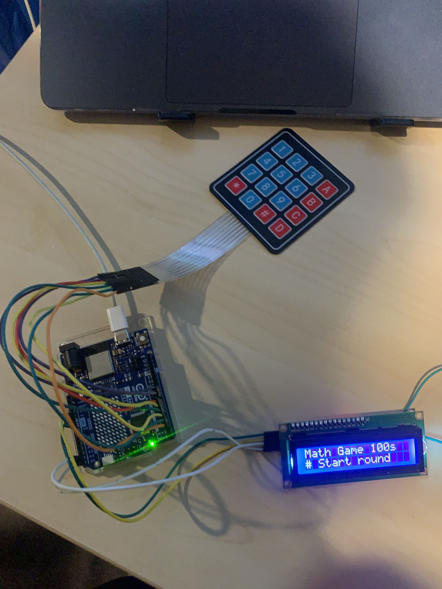

# Physical Computing Project 2026 - IT KMITL

**Offbeat 180 iq**

เกมคำนวณเลข 180 iq ที่เล่นได้จริงบนฮาร์ดแวร์ ใช้ Arduino UNO, Keypad 4×4 และจอ LCD 16×2 แบบ I2C

## รายชื่อสมาชิก

| รหัสนักศึกษา | ชื่อ-นามสกุล |
|---|---|
| 65070183 | ภูวเดช อนันต์คูศรี |
| 67070206 | คณุตม์ บัวชู |
| 68070100 | ปัญฐารีย์ หงษ์ศิริมงคล |

## บทคัดย่อ

โครงงานนี้เป็นการพัฒนาเกมฝึกทักษะการคำนวณทางคณิตศาสตร์ที่เล่นได้จริงบนฮาร์ดแวร์ โดยใช้บอร์ด **Arduino UNO** เป็นตัวประมวลผลหลัก รับข้อมูลผ่าน **Keypad เมทริกซ์ 4×4** และแสดงผลผ่าน **จอ LCD 16×2 แบบ I2C** แนวคิดของเกมได้รับแรงบันดาลใจจากเกม 24 หรือเกมคำนวณ 180 iq ที่ผู้เล่นต้องนำตัวเลข 4 ตัวมาคำนวณด้วยเครื่องหมายบวก ลบ คูณ หาร ให้ได้ผลลัพธ์ตามที่กำหนด

ต่างจากเกมคำนวณ 180 iq แบบดั้งเดิม เป้าหมายของเกมนี้จะเปลี่ยนไปทุกข้อในช่วง **10–99** โดยระบบจะสุ่มตัวเลข 1–9 จำนวน 4 ตัว แล้วทดลองสุ่มเครื่องหมายจนได้ผลลัพธ์เป็นจำนวนเต็ม จึงรับประกันได้ว่า **ทุกโจทย์มีคำตอบอย่างน้อยหนึ่งแบบ** การคำนวณเป็นแบบเรียงจากซ้ายไปขวา (ไม่มีลำดับความสำคัญของเครื่องหมาย) ทำให้ผู้เล่นเห็นผลลัพธ์สะสมบนจอทุกครั้งที่กดปุ่ม

## วัตถุประสงค์

- เพื่อฝึกทักษะการคำนวณทางคณิตศาสตร์
- เพื่อพัฒนาเกมคำนวณทางคณิตศาสตร์ด้วยบอร์ด Arduino UNO
- เพื่อเพิ่มความสนุกและความท้าทายในการฝึกคิดคำนวณ
- เพื่อพัฒนาทักษะการเขียนโปรแกรมควบคุมอุปกรณ์ฮาร์ดแวร์

## อุปกรณ์

- Arduino UNO R4 × 1
- Membrane Keypad 4×4 × 1
- LCD  I2C × 1
- สายจัมเปอร์ และสาย USB Type-C

## การต่อวงจร

| อุปกรณ์ | ขาอุปกรณ์ | ขา Arduino |
|---|---|---|
| Keypad | Row 1–4 | D9, D8, D7, D6 |
| Keypad | Col 1–4 | D5, D4, D3, D2 |
| LCD I2C | GND | GND |
| LCD I2C | VCC | 5V |
| LCD I2C | SDA | A4 |
| LCD I2C | SCL | A5 |

## วิธีอัปโหลดโค้ด

1. ติดตั้ง [Arduino IDE](https://www.arduino.cc/en/software)
2. ติดตั้งไลบรารี **LiquidCrystal I2C** ผ่าน Library Manager
3. เปิดไฟล์ [`keypad_game.ino`](keypad_game.ino) เลือกบอร์ด Arduino UNO และพอร์ตที่เสียบอยู่
4. กด Upload

## วิธีเล่น

| ปุ่ม | หน้าที่ |
|---|---|
| `0`–`9` | เลือกตัวเลขจากโจทย์ |
| `A` `B` `C` `D` | เครื่องหมาย + − × ÷ |
| `*` | ล้างคำตอบ เริ่มคิดโจทย์เดิมใหม่ |
| `#` | เริ่มเกม / ส่งคำตอบ / ข้ามข้อ (ถ้ายังไม่กดตัวเลข) |

- เริ่มต้นมีเวลา **100 วินาที**
- ต้องใช้ตัวเลขครบทั้ง 4 ตัว ตัวละหนึ่งครั้ง
- ตอบถูกได้ **1 คะแนน** และเวลาเพิ่ม **10 วินาที**
- เกมจบเมื่อหมดเวลา กด `#` เพื่อเล่นใหม่

## เว็บไซต์โปรเจกต์

https://pp-uu-rr-ee.github.io/Physical-Keypad-Game/

## คลิปวิดีโอ

https://youtu.be/54avf26kf_c

## โปสเตอร์

[📄 ดูโปสเตอร์โปรเจกต์ (PDF)](project_offbeat.pdf)